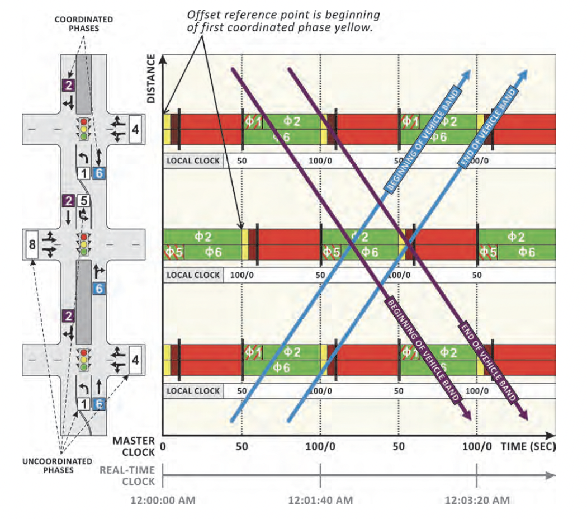
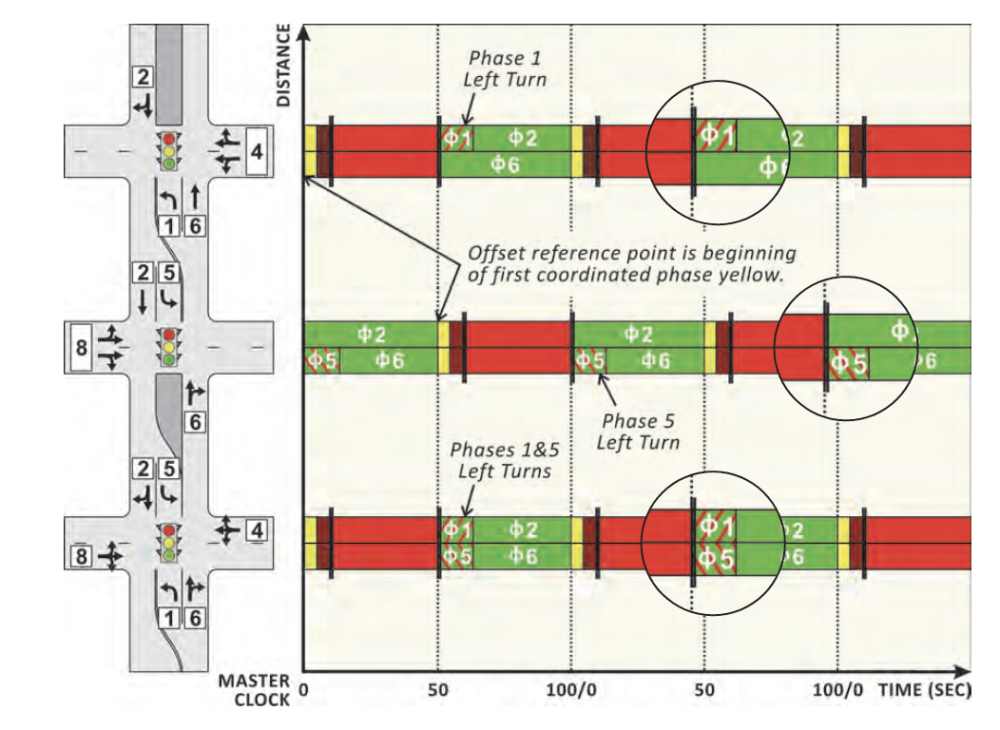

## Questions
- [ ] Is coordinated phase green time calculated as in `Step 1`?
- [ ] How do we determine left turn type?
	- [ ] Is step 4 correct?
	- [ ] Do we need intersection geometry for this?
- [ ] When doing split monitor/history, what counts as phase actual split?
	- [ ] According to NTCIP `Phase Ons 1.3.6.1.4.1.1206.4.2.1.1.4.1.10`: "The phase is ON during the `Green`, `Yellow`, & `Red Clearance` intervals of that phase."

---

## Data needed per intersection
- Active pattern → cycle time, offset, reference point (GREEN / YELLOW / RED / END)
- Split table → split time per phase, which phase is coordinated (Coord flag)
- Timing plan → yellow change and red clearance per phase
- Ring sequence → e.g. Ring 1: 1,2,a,3,4,b / Ring 2: 5,6,a,7,8,b
- Channel table → `channelGreenType` per phase (protected / permissive / flashYellow)

---

## Step 1 — Calculate coordinated phase green duration
```
green = splitTime − yellowChange − redClear
```

---

## Step 2 — Find where coordinated phase green starts on the X axis

The offset anchors to the first coordinated phase in the ring sequence.

| Reference point | greenStart                           |
| --------------- | ------------------------------------ |
| GREEN           | `offset`                             |
| YELLOW          | `offset − green`                     |
| RED             | `offset − green − yellow − redClear` |

If greenStart is negative → add cycleTime to wrap into range.

---

## Step 3 — Draw the coordinated phase bars

Starting from greenStart, draw three consecutive bars:
- **Bright green** → duration = green
- **Yellow** → duration = yellowChange
- **Dark red** → duration = redClear

---

## Step 4 — Place left turn phase adjacent to coordinated phase

Only draw phases immediately before or after the coordinated phase in the ring sequence (Ph1/Ph5 in a standard NEMA ring). Do not draw cross-street phases (Ph3, Ph4, Ph7, Ph8).

Determine the left turn type from `channelGreenType`:

- **protected** → draw the full split time as a **diagonal hatched block**. Through movement is blocked for the entire duration.
- **permissive** → **do not draw**. Left turn runs concurrently with through movement, does not block it.

Position: if lead left turn (before coordinated phase) → place immediately before greenStart, working backward by the left turn split time. If lag left turn (after coordinated phase) → place immediately after the coordinated phase red clearance ends.

---

## Step 5 — Draw the barrier lines

- **Horizontal line** between Ring 1 and Ring 2 rows — full cycle width
- **Vertical line at barrier a** — where coordinated phase red clearance ends
- **Vertical line at barrier b** — end of cycle (x = cycleTime)

---

## Step 6 — Draw progression bands

For each link between consecutive intersections, draw two diagonal bands:

- **NB band** — departs from the bottom of Ring 2 at the downstream intersection, slopes upward-right toward the bottom of Ring 2 at the upstream intersection. Slope = link distance ÷ progression speed.
- **SB band** — departs from the top of Ring 1 at the upstream intersection, slopes downward-right toward the top of Ring 1 at the downstream intersection.

Band width at each intersection = overlap between the projected departure window and the coordinated phase green window at the arrival intersection. If there is no overlap → no band is drawn for that link and direction.

---

## Other phases in ring
This represents the time the coordinated phase is at red (cross-street phases running). No separate bars are drawn for cross-street phases.

---

## Reference — Vehicle progression bands (Signal Timing Manual Exhibit 7-1)



*Exhibit 7-1 from the Signal Timing Manual. Shows the full time-space diagram with SB (blue) and NB (purple) vehicle progression bands across three intersections. The master clock is on the bottom X axis. Local clocks are shown below each intersection's ring-and-barrier diagram, with zero aligned to the offset reference point (beginning of first coordinated phase yellow). The real-time clock at the bottom shows the relationship to actual time of day. Uncoordinated phases are shown in red — coordinated phases (Ph2/Ph6) in green.*

---

## Reference — Protected left turn phasing (Signal Timing Manual Exhibit 7-2)



*Exhibit 7-2 from the Signal Timing Manual. Shows Ph1 and Ph5 as protected lead left turn phases (hatched blocks) adjacent to the coordinated through phases Ph2 and Ph6. The offset reference point is the beginning of the first coordinated phase yellow. Cross-street phases (Ph3, Ph4, Ph7, Ph8) are not drawn — represented by the red background only.*
